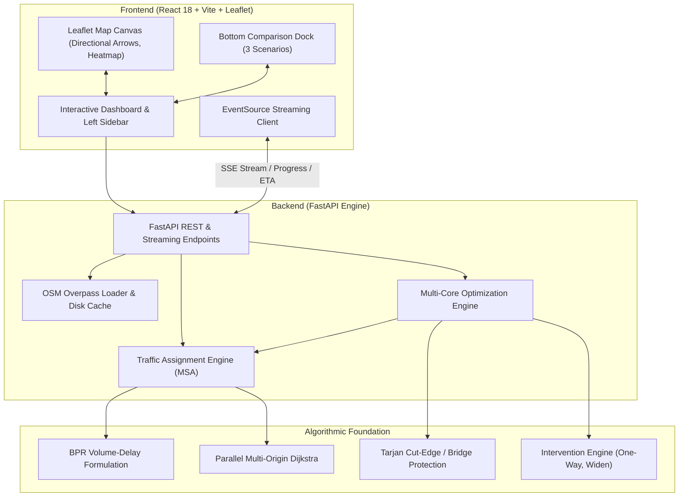

# 🚦 UrbanFlow — Urban Traffic Graph Optimization Engine

[](https://fastapi.tiangolo.com)
[](https://reactjs.org/)
[](https://vitejs.dev/)
[](https://leafletjs.com/)
[](https://www.python.org/)
[](LICENSE)

**UrbanFlow** is a high-performance urban traffic network simulation and decision-support engine. It models road infrastructure as a directed graph, simulates **User Equilibrium (Wardrop's First Principle)** using the **Method of Successive Averages (MSA)** with **BPR volume-delay functions**, automatically identifies **Braess Paradox shortcuts** and severe bottlenecks, and computes optimal infrastructure interventions (**One-Way street conversions** and **arterial road widenings**).

---

## 📑 Table of Contents
1. [Key Features](#-key-features)
2. [System Architecture](#-system-architecture)
3. [Traffic Simulation Engine & Algorithms](#-traffic-simulation-engine--algorithms)
   - [Graph & Demand Formulation](#1-graph--demand-formulation)
   - [BPR Congestion Function](#2-bpr-congestion-function)
   - [Wardrop User Equilibrium & MSA Algorithm](#3-wardrop-user-equilibrium--msa-algorithm)
   - [Parallel Origin-Based Shortest Paths](#4-parallel-origin-based-shortest-paths)
4. [Optimization Engine & Intervention Algorithms](#-optimization-engine--intervention-algorithms)
   - [The Network Design Problem & Braess Paradox](#1-the-network-design-problem--braess-paradox)
   - [Candidate Selection & Corridor Alternative Analysis](#2-candidate-selection--corridor-alternative-analysis)
   - [One-Way Street Conversions & Directionality](#3-one-way-street-conversions--directionality)
   - [Arterial Corridor Widening](#4-arterial-corridor-widening)
   - [Multi-Core Evaluation & Real-Time Streaming](#5-multi-core-evaluation--real-time-streaming)
   - [Priority-Based Combined Optimization](#6-priority-based-combined-optimization)
5. [Interactive Dashboard & User Workflow](#-interactive-dashboard--user-workflow)
6. [Getting Started & Installation](#-getting-started--installation)
   - [One-Click Launcher (Linux / macOS)](#one-click-launcher-linux--macos)
   - [One-Click Launcher (Windows)](#one-click-launcher-windows)
   - [Manual Setup](#manual-setup)
7. [API Reference](#-api-reference)
8. [Project Directory Structure](#-project-directory-structure)

---

## 🌟 Key Features

- **User Equilibrium Simulation (MSA)**: Full multi-commodity traffic assignment modeling user routing behavior where no driver can unilaterally reduce trip time by switching routes.
- **Braess Paradox Identification via One-Way Conversions**: Replaces simple road closures with pragmatic one-way conversions: eliminates conflicting counter-flow and selfish Braess shortcuts while preserving vital local property access.
- **Directional Flow Visualization**: Visualizes one-way street directions with oriented directional arrows, cardinal bearings (`NB`, `SB`, `EB`, `WB`), and endpoint routing badges.
- **Multi-Core Parallel Computing**: Utilizes all available CPU cores via parallel Dijkstra origin-batching for simulation and multi-threaded worker pools for candidate optimization.
- **Real-Time Streaming Progress & ETA**: Live Server-Sent Events (SSE) stream simulation and optimization progress with dynamic estimated time remaining.
- **3-Scenario Bottom Comparison Dock**: Evaluates **One-Ways Only**, **Widenings Only**, and **Combined Interventions** side-by-side with clickable corridor focus on map.
- **Dynamic Real-Time Road Density Filter**: In-memory graph caching allows instant road density filtering without losing road topology or requiring re-downloads.
- **OpenStreetMap Import & Disk Caching**: On-demand downloading of any arbitrary global bounding box via Overpass API with local cache persistence.

---

## 🏛 System Architecture

UrbanFlow is organized as a decoupled, modern client-server architecture:



---

## 🧮 Traffic Simulation Engine & Algorithms

### 1. Graph & Demand Formulation
The transportation network is modeled as a directed graph $G = (V, E)$:
- **Vertices ($V$)**: Intersections, roundabouts, and centroid zones.
- **Edges ($E$)**: Directed road segments defined by:
  - Free-flow travel time: $t_{0,e} = \frac{L_e}{v_{0,e}}$ (derived from length $L_e$ and free-flow speed $v_{0,e}$).
  - Practical capacity: $C_e$ in vehicles per hour (vph).
  - Number of lanes: $l_e$.
  - Road functional hierarchy (motorway, trunk, primary, secondary, tertiary, residential).
- **Origin-Destination Demand ($D$)**: Set of trip tuples $(o_k, d_k, q_k)$ where $q_k$ represents hourly vehicle trip volume between origin node $o_k$ and destination node $d_k$, calibrated using gravity models and road hierarchy.

### 2. BPR Congestion Function
To capture the nonlinear relationship between traffic volume and queuing delay, link travel times are computed using the **Bureau of Public Roads (BPR)** formulation:

$$t_e(v_e) = t_{0,e} \left[ 1 + \alpha \left(\frac{v_e}{C_e}\right)^\beta \right]$$

- $v_e$: Assigned hourly traffic volume on link $e$ (vph).
- $C_e$: Link design capacity (vph).
- $\alpha, \beta$: Calibrated congestion parameters (default $\alpha = 0.15$, $\beta = 4.0$).
- When $v_e \ll C_e$, $t_e \approx t_{0,e}$ (free-flow). When $v_e \ge C_e$, travel time increases steeply with the 4th power of the volume-to-capacity ($V/C$) ratio.

### 3. Wardrop User Equilibrium & MSA Algorithm
Traffic flows reach **Wardrop's First Principle of User Equilibrium (UE)** when journey times on all actively used routes between an OD pair are equal, and no driver can unilaterally reduce their travel time by choosing an alternative path:

$$\forall (o, d), \quad t_p = \min_{p' \in P_{od}} t_{p'} \quad \text{for all paths } p \in P_{od} \text{ where flow } f_p > 0$$

UrbanFlow solves this nonlinear convex optimization problem using the **Method of Successive Averages (MSA)**:

```
Algorithm: Method of Successive Averages (MSA) User Equilibrium
----------------------------------------------------------------
Input: Network G = (V, E), Demand Matrix D, Config (max_iter, tolerance)
Output: Equilibrium link flows v*, Link travel times t*, Summary metrics

1. Set iteration k = 1.
2. Initialize link flows: v^(0)_e = 0 for all e in E.
3. Compute initial link costs: t^(1)_e = t_0,e for all e in E.
4. While k <= max_iter:
    a. Parallel All-or-Nothing (AON) Assignment:
       For each origin o in D:
           Compute shortest path tree from o using Dijkstra on current weights t^(k).
           For each destination d with demand q_od:
               Trace shortest path and accumulate flow q_od onto auxiliary vector y^(k).
    b. Calculate step size: lambda_k = 1.0 / k.
    c. Flow Update (Convex combination):
       v^(k)_e = (1 - lambda_k) * v^(k-1)_e + lambda_k * y^(k)_e,  for all e in E.
    d. Cost Update:
       t^(k+1)_e = t_0,e * [ 1 + alpha * (v^(k)_e / C_e)^beta ],   for all e in E.
    e. Convergence Check:
       RelGap = sum_e |v^(k)_e - v^(k-1)_e| / max(sum_e v^(k)_e, 1.0)
       If RelGap < tolerance:
           Break (Equilibrium reached).
    f. k = k + 1.
5. Compute network summary metrics:
   Average Travel Time T_avg = sum_e (v_e * t_e) / sum_e (v_e)
   Network Average Speed S_avg = sum_e (v_e * L_e) / sum_e (v_e * t_e)
```

### 4. Parallel Origin-Based Shortest Paths
Because shortest-path computations from distinct origin nodes are mutually independent, UrbanFlow partitions origins across a `ThreadPoolExecutor` worker pool. Each worker computes all-pairs shortest paths for a subset of origins using single-source Fibonacci heap Dijkstra, yielding near-linear speedups on multi-core workstations.

---

## 🔬 Optimization Engine & Intervention Algorithms

### 1. The Network Design Problem & Braess Paradox
In 1968, mathematician Dietrich Braess demonstrated that adding capacity to a congested road network can paradoxically **increase** overall travel times because self-interested drivers crowd into a new shortcut, overloading surrounding intersections. Conversely, **restricting** or **converting** such shortcuts to one-way streets forces traffic onto distributed arterial bypasses, reducing network-wide delay.

### 2. Candidate Selection & Corridor Alternative Analysis
Testing every permutation of road interventions on large urban networks is computationally intractable ($O(2^{|E|})$). UrbanFlow uses a targeted **Corridor Alternative Analysis**:

1. **Topology & Connectivity Safeguard (Tarjan's Bridge Algorithm)**:
   - Evaluates the undirected topology $G_{\text{undir}}$ using Tarjan's DFS bridge-finding algorithm ($O(|V| + |E|)$).
   - If link $e$ is a bridge (cut-edge), closing or making it one-way in an isolated direction could sever connectivity. Bridges with no alternative paths are excluded from removal/one-way consideration.
2. **Shortcut Viability Filter**:
   - For each active road ($v_e \ge 50$ vph), the engine temporarily removes the link and calculates alternative shortest path hops between endpoints ($u \rightarrow v$).
   - Links with viable alternative parallel corridors and high volume-to-capacity ratios are scored:
     $$\text{Score}_{\text{shortcut}} = \frac{V_e}{C_e} \times \frac{1}{\max(1, \min(\text{Hops}_{\text{alt}}, 8))}$$
3. **Bottleneck Filter**:
   - Roads with severe congestion ($V/C \ge 0.70$) are ranked as candidates for physical lane expansion.
4. **Deduplication**:
   - The candidate builder strictly deduplicates candidates so no road segment is simultaneously proposed for both one-way conversion and widening.

### 3. One-Way Street Conversions & Directionality

Rather than permanently blocking roads, UrbanFlow applies **Designated One-Way Conversions (`ONE_WAY`)**:

```
One-Way Conversion Operation on Link e = (u -> v):
---------------------------------------------------
1. Forward Edge (u -> v) is preserved as the designated travel corridor.
2. Opposing Counter-Flow Edge (v -> u) is removed from the network graph:
   del edge_map[opp_edge.id]
3. Opposing road space is reclaimed for forward travel:
   lanes_fwd = lanes_fwd + lanes_opp
   capacity_fwd = capacity_fwd * 1.40  (+40% forward capacity boost)
```

#### Why Direction Matters
Converting a corridor into a one-way street is fundamentally directional:
- **Asymmetric Demand**: Morning peak traffic heading into downtown ($u \rightarrow v$) may carry $1,200$ vph while reverse flow ($v \rightarrow u$) carries only $200$ vph. Directing the one-way forward accommodates peak commuters while diverting light reverse traffic to parallel streets. Flipping the direction would cause massive gridlock.
- **Parallel Bypass Capacity**: The engine identifies parallel corridors (e.g. parallel avenues) that absorb diverted reverse traffic. If the reverse direction has ample bypasses, the one-way conversion succeeds with large travel time savings.

### 4. Arterial Corridor Widening
For physical bottlenecks where demand is inherently heavy in both directions, the engine evaluates **Corridor Capacity Expansion (`WIDEN`)**:
- Adds $+1$ travel lane ($l_e' = l_e + 1$).
- Expands design capacity by $+50\%$ ($C_e' = 1.50 \times C_e$).
- Evaluates queue dissipation, network speed increase, and congestion relief.

### 5. Multi-Core Evaluation & Real-Time Streaming
Candidate evaluations run concurrently across all available CPU threads using Python's `asyncio` and `concurrent.futures`. As each candidate completes, progress and discovered recommendations are immediately streamed to the browser over Server-Sent Events (`/api/optimizer/stream`), providing:
- Percentage completed.
- Current candidate road name and intervention type.
- Smooth dynamic **Estimated Time of Arrival (ETA)**.

### 6. Priority-Based Combined Optimization
The engine evaluates three distinct scenario suites:
1. **One-Ways Only**: All non-conflicting one-way conversions simulated simultaneously.
2. **Widenings Only**: All non-conflicting corridor widenings simulated simultaneously.
3. **Combined Interventions**:
   - **One-Way Priority**: Applies all discovered one-way conversions first, then adds non-conflicting widenings.
   - **Widening Priority**: Applies all bottleneck widenings first, then adds non-conflicting one-way conversions.

---

## 🖥 Interactive Dashboard & User Workflow

The frontend dashboard provides a streamlined 3-step decision workflow:

```
[ Step 1: Simulate Baseline ] ➔ [ Step 2: Run Multi-Core Optimizer ] ➔ [ Bottom Dock: Compare & Inspect ]
```

1. **Step 1 — Baseline Network Simulation**:
   - Simulates current traffic equilibrium under chosen rush hour demand (50% to 200%).
   - Displays baseline travel time (mins), average network speed (km/h), and total vehicle delay.
2. **Step 2 — Candidate Discovery & Streaming**:
   - Discovers high-impact interventions with real-time ETA.
   - Presents compact, intuitive cards with exact **Change** (`Convert to 1-way`, `Add +1 lane`) and **Effect** (`Eliminates Braess bottleneck`, `Clears queue`).
   - Clicking any recommendation card immediately zooms to and highlights that road corridor on the map.
3. **Bottom Comparison Dock**:
   - Shows **1. One-Ways Only**, **2. Corridor Widenings**, and **3. Combined** scenarios side-by-side.
   - Each applied change is an interactive clickable chip (`Inspect ➔`) that centers the map and displays the Route Inspector.
4. **Interactive Map Canvas**:
   - **Directional Flow Arrows**: Oriented chevrons (`▲`) rendered directly on one-way streets pointing along the permitted bearing.
   - **Route Inspector**: Click any road segment to view real-time volume, capacity, speed, $V/C$ ratio, and one-way flow status.
   - **Real-Time Road Density**: Adjust the slider to filter road classifications (primary, secondary, residential) instantly using in-memory cached subgraphs.

---

## 🚀 Getting Started & Installation

### Prerequisites
- **Python**: Version 3.10 or higher.
- **Node.js**: Version 18.0 or higher (`pnpm` recommended, `npm` supported).

---

### One-Click Launcher (Linux / macOS)

The unified `run.sh` script automatically creates the Python virtualenv, installs backend and frontend dependencies, configures `.env` files, and starts both servers:

```bash
chmod +x run.sh
./run.sh
```

- **Frontend Application**: [http://localhost:3000](http://localhost:3000)
- **FastAPI Documentation**: [http://localhost:8000/docs](http://localhost:8000/docs)
- Press `Ctrl+C` to gracefully terminate both servers.

---

### One-Click Launcher (Windows)

On Windows, run the companion batch launcher:

```cmd
run.bat
```

*(Or simply double-click `run.bat` or `start.bat` in Windows Explorer)*. It handles Python virtual environment creation, pip package installation, frontend dependency installation, health checks, and unified execution.

---

### Manual Setup

If you prefer to run services manually in separate terminals:

#### Terminal 1 — Backend (FastAPI):
```bash
cd backend
python -m venv venv
source venv/bin/activate       # On Windows: venv\Scripts\activate
pip install --upgrade pip
pip install -r requirements.txt
PYTHONPATH=. uvicorn app.main:app --host 0.0.0.0 --port 8000 --reload
```

#### Terminal 2 — Frontend (Vite):
```bash
cd frontend
pnpm install                  # Or: npm install
pnpm run dev                  # Or: npm run dev
```

---

## 📡 API Reference

UrbanFlow provides comprehensive REST and streaming endpoints:

| Endpoint | Method | Description |
|---|---|---|
| `/api/health` | `GET` | Health check endpoint returning engine status. |
| `/api/graphs` | `GET` | List all available scenario networks (Kochi Central, New York, Braess 3-Route, etc.). |
| `/api/graphs/{graph_id}` | `GET` | Fetch complete graph topology (nodes, edges, geometry, lane counts). |
| `/api/simulation/run` | `POST` | Execute User Equilibrium simulation on a given graph with demand multiplier. |
| `/api/simulation/stream` | `POST` | Stream live MSA iterations and flow assignment progress via SSE. |
| `/api/interventions/evaluate`| `POST` | Evaluate specific intervention actions (`ONE_WAY`, `WIDEN`, `CLOSE`) against baseline. |
| `/api/optimizer/recommendations` | `POST` | Synchronously discover optimal one-way and widening candidates. |
| `/api/optimizer/stream` | `POST` | Concurrently evaluate all candidates across CPU threads with live SSE progress & ETA. |
| `/api/osm/fetch` | `POST` | Download, clean, and cache road networks for any bounding box via OpenStreetMap Overpass. |
| `/api/osm/random` | `POST` | Fetch a random real-world urban district from a curated global city registry. |

Interactive OpenAPI documentation is available at [http://localhost:8000/docs](http://localhost:8000/docs).

---

## 📁 Project Directory Structure

```
urbanflow/
├── backend/                              # FastAPI Simulation & Optimization Engine
│   ├── app/
│   │   ├── api/                          # REST & Streaming route controllers
│   │   │   ├── routes_graphs.py          # Scenario networks
│   │   │   ├── routes_simulation.py      # Simulation execution & SSE streaming
│   │   │   ├── routes_optimizer.py       # Multi-core optimizer & streaming
│   │   │   ├── routes_interventions.py   # Intervention application & diffs
│   │   │   ├── routes_osm.py             # OSM Overpass fetch & random selection
│   │   │   └── routes_analysis.py        # Bottlenecks & corridor metrics
│   │   ├── core/                         # Core algorithmic implementations
│   │   │   ├── bpr.py                    # BPR link congestion functions
│   │   │   ├── msa.py                    # Method of Successive Averages equilibrium
│   │   │   ├── optimizer.py              # Candidate discovery & Braess evaluation
│   │   │   ├── intervention.py           # One-way, widening, and closure modifiers
│   │   │   ├── osm_loader.py             # Overpass extraction & node/edge parsers
│   │   │   └── graph_model.py            # Pydantic schemas & network structures
│   │   └── main.py                       # FastAPI application entrypoint
│   ├── tests/                            # Pytest test suite (13 integration tests)
│   └── requirements.txt                  # Python dependencies
│
├── frontend/                             # React 18 + TypeScript + Vite Dashboard
│   ├── src/
│   │   ├── services/
│   │   │   └── api.ts                    # Backend API client & SSE streaming reader
│   │   ├── types/
│   │   │   └── index.ts                  # TypeScript interfaces matching backend models
│   │   ├── App.tsx                       # Main application dashboard & Leaflet canvas
│   │   └── index.css                     # Premium light-mode styling & micro-interactions
│   ├── package.json
│   └── vite.config.ts
│
├── specs/                                # System architecture & design contracts
│   ├── 00_SYSTEM_ARCHITECTURE.md
│   ├── 01_BACKEND_SPEC.md
│   ├── 02_FRONTEND_SPEC.md
│   └── 03_MAP_DATA_PIPELINE_SPEC.md
│
├── run.sh                                # Unified launcher for Linux / macOS
├── run.bat                               # Unified launcher for Windows
├── start.sh                              # Alias shortcut launcher (Linux/macOS)
└── start.bat                             # Alias shortcut launcher (Windows)
```

---

## 🧪 Testing

To verify backend algorithmic integrity and API endpoints:
```bash
PYTHONPATH=backend backend/venv/bin/pytest backend/tests/
```

To verify frontend TypeScript compilation and production packaging:
```bash
cd frontend && npm run build
```

---

## 📄 License
This project is licensed under the MIT License.
