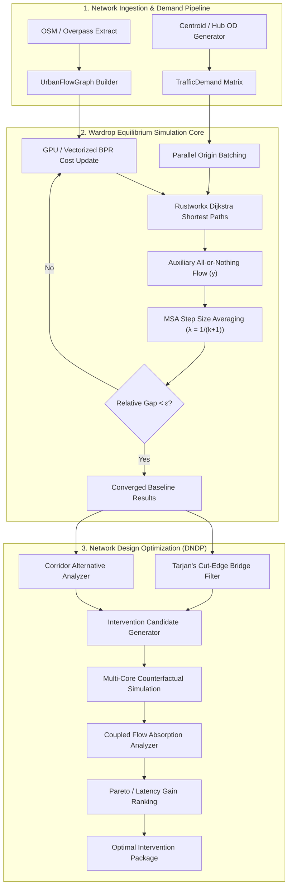
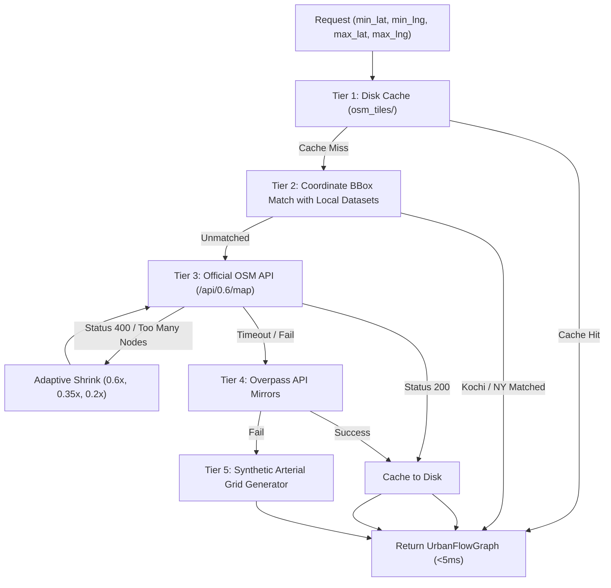

# UrbanFlow Architecture & Algorithm Reference Manual

This document provides an exhaustive, step-by-step engineering and mathematical specification of every algorithm utilized within the **UrbanFlow** platform.

UrbanFlow is a high-performance urban traffic simulation, equilibrium modeling, and network design optimization engine. It couples non-linear traffic assignment under Wardrop Equilibrium with topological graph analysis and heuristic network design to detect bottlenecks and resolve phenomena such as the **Braess Paradox**.

---

## Table of Contents

1. [High-Level Architectural Overview](#1-high-level-architectural-overview)
2. [Algorithm 1: Traffic Assignment via Method of Successive Averages (MSA)](#2-algorithm-1-traffic-assignment-via-method-of-successive-averages-msa)
3. [Algorithm 2: Single-Source Shortest Path (Rustworkx Dijkstra & Origin Batching)](#3-algorithm-2-single-source-shortest-path-rustworkx-dijkstra--origin-batching)
4. [Algorithm 3: Link Congestion & Cost Performance Functions (BPR, Linear, & Braess)](#4-algorithm-3-link-congestion--cost-performance-functions-bpr-linear--braess)
5. [Algorithm 4: Graph Topology & Safety Verification (Tarjan's Bridge-Finding)](#5-algorithm-4-graph-topology--safety-verification-tarjans-bridge-finding)
6. [Algorithm 5: Shortest-Path Edge Betweenness Centrality (Brandes' Algorithm)](#6-algorithm-5-shortest-path-edge-betweenness-centrality-brandes-algorithm)
7. [Algorithm 6: Network Intervention & Optimization Engine (DNDP Heuristic Search)](#7-algorithm-6-network-intervention--optimization-engine-dndp-heuristic-search)
8. [Algorithm 7: Coupled Widening & Traffic Absorption Optimization](#8-algorithm-7-coupled-widening--traffic-absorption-optimization)
9. [Algorithm 8: Braess Paradox Analytical & Simulation Engines](#9-algorithm-8-braess-paradox-analytical--simulation-engines)
10. [Algorithm 9: Spatial Ingestion, BBox Shrinkage, & Synthetic OD Matrix Generation](#10-algorithm-9-spatial-ingestion-bbox-shrinkage--synthetic-od-matrix-generation)
11. [Algorithm Complexity & Execution Summary Matrix](#11-algorithm-complexity--execution-summary-matrix)

---

## 1. High-Level Architectural Overview

UrbanFlow models an urban road network as a directed weighted multigraph $G = (V, E)$, where vertices $V$ denote intersections or centroids, and directed edges $E$ denote road segments with explicit capacities, speed limits, lengths, and congestion coefficients.



---

## 2. Algorithm 1: Traffic Assignment via Method of Successive Averages (MSA)

- **Source Location**: [`backend/app/core/assignment.py:simulate_traffic_msa`](file:///devdrive/github/projects/urbanflow/urbanflow/backend/app/core/assignment.py#L289-L600)
- **Mathematical Class**: Convex Programming / Fixed-Point Iteration (Robbins-Monro)
- **Target Objective**: **Wardrop's First Principle of User Equilibrium (UE)**

### 2.1 Theoretical Formulation

Under User Equilibrium, journey times on all routes actually used are equal, and less than or equal to those which would be experienced by a single vehicle on any unused route. This corresponds to the first-order Karush-Kuhn-Tucker (KKT) conditions of the **Beckmann Convex Optimization Formulation**:

$$\min_{\mathbf{v}} Z(\mathbf{v}) = \sum_{e \in E} \int_{0}^{v_e} t_e(w) \, dw$$

$$\text{subject to:} \quad \sum_{p \in \mathcal{P}_{od}} f_p = D_{od} \quad \forall (o, d) \in \mathcal{OD}, \quad v_e = \sum_{p \in \mathcal{P}} f_p \delta_{ep}, \quad f_p \ge 0$$

Where:
- $v_e$: Total traffic flow on edge $e \in E$ (vehicles per hour).
- $t_e(w)$: Link performance travel time cost function at volume $w$.
- $f_p$: Flow assigned to route $p \in \mathcal{P}_{od}$.
- $D_{od}$: Aggregate travel demand between origin $o$ and destination $d$.
- $\delta_{ep} \in \{0, 1\}$: Path-edge incidence indicator.

### 2.2 Step-by-Step Algorithm Execution

```
Algorithm: Method of Successive Averages (MSA)
─────────────────────────────────────────────────────────────────────────────
Input : Graph G = (V, E), Demand Matrix D, MaxIterations K, Tolerance ε
Output: Equilibrium link flows v*, edge travel times t*, bottleneck metrics

1. Initialize edge flows:
   v_e^(0) ← 0 for all e ∈ E
   costs_e^(0) ← free_flow_time_sec(e) = l_e / (v_{free, e} / 3.6)

2. For iteration k = 1 to K do:
   a. Compute link travel times from current volume:
      costs_e^(k) ← Calculate_BPR(t_{0, e}, v_e^(k-1), c_e, α, β)

   b. Auxiliary All-or-Nothing (AON) Assignment:
      aux_flows_e ← 0 for all e ∈ E
      Group all OD pairs by origin node o ∈ V
      For each origin o:
          Compute single-source shortest path tree to all reachable destinations
          using Dijkstra(G, weights = costs^(k))
          For each destination d with demand D_{od} > 0:
              Trace shortest path P_{od}
              For each edge e ∈ P_{od}:
                  aux_flows_e ← aux_flows_e + D_{od}

   c. Successive Average Update (Predetermined step size):
      λ_k ← 1.0 / (k + 1)
      v_e^(k) ← (1 - λ_k) · v_e^(k-1) + λ_k · aux_flows_e

   d. Convergence Evaluation (Relative Flow Gap):
      Δ_flow ← ∑_{e ∈ E} |v_e^(k) - v_e^(k-1)|
      Total_flow ← ∑_{e ∈ E} v_e^(k)
      Relative_Gap ← Δ_flow / max(Total_flow, 1.0)

      If Relative_Gap < ε and k ≥ 4 then:
          Equilibrium converged; break loop

3. Post-Processing & Realism Adjustments:
   a. Add pervasive baseline urban circulation flow:
      v_e* ← max(v_e^(k), capacity_e · RoadTypeCirculationFactor)
   b. Compute final congested travel times, speeds, and V/C ratios
   c. Classify bottlenecks where v_e* / c_e ≥ 0.95
─────────────────────────────────────────────────────────────────────────────
```

### 2.3 Mathematical Proof of Convergence

The predetermined step size $\lambda_k = \frac{1}{k+1}$ satisfies the classical **Robbins-Monro convergence conditions**:

$$\sum_{k=1}^{\infty} \lambda_k = \infty \quad \text{and} \quad \sum_{k=1}^{\infty} \lambda_k^2 < \infty$$

Because $\sum \lambda_k = \infty$, the algorithm can travel arbitrarily far from the starting point to correct initial bias. Because $\sum \lambda_k^2 < \infty$, the step sizes decrease fast enough to dampen oscillations caused by non-linear travel time feedback, ensuring almost sure convergence to the Beckmann stationary point.

---

## 3. Algorithm 2: Single-Source Shortest Path (Rustworkx Dijkstra & Origin Batching)

- **Source Location**: [`backend/app/core/assignment.py:_dijkstra_origins_batch`](file:///devdrive/github/projects/urbanflow/urbanflow/backend/app/core/assignment.py#L75-L132)
- **Mathematical Class**: Graph Shortest Path (Greedy with Priority Queue)
- **Engine Optimization**: Rust-compiled C-extensions via `rustworkx` with closure cost lookups

### 3.1 Step-by-Step Execution

1. **Topology Precompilation**:
   - The graph topology is mapped once into an immutable Rustworkx `rx.PyDiGraph` instance.
   - Nodes are mapped to zero-indexed integer IDs $[0, |V|-1]$.
   - Edges store their respective array index $[0, |E|-1]$ as weight payload.
2. **Origin Partitioning**:
   - Origin-Destination pairs are grouped by origin: $\mathcal{O}(o) = \{(d_1, vol_1), (d_2, vol_2), \dots\}$.
   - Unique origins are partitioned into contiguous batches across $N_{cores}$ worker threads.
3. **Closure-Based Cost Evaluation**:
   - Instead of updating the weight payload on every edge in Python (which incurs heavy GIL serialization penalties), the worker function passes a closure:
     ```python
     def cost_fn(edge_arr_idx: int) -> float:
         return float(costs_shared[edge_arr_idx])
     ```
   - Rustworkx executes Dijkstra directly in native Rust, invoking the closure only when relaxing candidate edges.
4. **Path Reconstruction & Auxiliary Flow Accumulation**:
   - For each destination $d$, the sequence of predecessor node indices is retrieved from the shortest-path tree.
   - Directed edge pairs $(u, v)$ are mapped back to edge indices using a precomputed hash table `edge_index_map`.
   - Demand $D_{od}$ is atomically accumulated onto `aux_flows[edge_idx]`.

---

## 4. Algorithm 3: Link Congestion & Cost Performance Functions (BPR, Linear, & Braess)

- **Source Location**: [`backend/app/core/bpr.py:calculate_link_travel_time`](file:///devdrive/github/projects/urbanflow/urbanflow/backend/app/core/bpr.py#L8-L40)
- **Mathematical Class**: Empirical Non-linear Link Congestion Mechanics

UrbanFlow supports three distinct cost models to handle real-world arterials, linear approximations, and classic theoretical paradox networks.

### 4.1 Bureau of Public Roads (BPR) Model

Standard highway traffic congestion function developed by the US Federal Highway Administration:

$$t_e(v_e) = t_{0, e} \cdot \left[ 1 + \alpha \cdot \left(\frac{v_e}{c_e}\right)^\beta \right]$$

- **Free-flow time**: $t_{0, e} = \frac{l_e}{v_{free, e} / 3.6}$ (seconds).
- **Default Parameters**: $\alpha = 0.15$, $\beta = 4.0$.
- **Behavioral Zones**:
  - $v_e \le 0.75 c_e$: Free-flow regime; delay penalty is virtually negligible ($< 4.7\%$).
  - $v_e \approx c_e$: Nominal capacity; travel time increases by factor $(1 + \alpha) = 1.15 \times$.
  - $v_e > 1.0 c_e$: Oversaturation regime; the quartic exponent $\beta = 4$ produces an exponential delay spike reflecting queuing delay and shockwave propagation.

### 4.2 Linear Congestion Model

Used for linearized network analysis and fast gradient projections:

$$t_e(v_e) = t_{0, e} \cdot \left[ 1 + \alpha \cdot \left(\frac{v_e}{\max(1, c_e)}\right) \right]$$

### 4.3 Braess Exact Theoretical Model

Used for synthetic replication of classic literature proofs:

$$t_e(v_e) = t_{0, e} + \alpha \cdot v_e$$

- Flow-dependent links ($A \to B, C \to D$): $t_0 = 0$, $\alpha = 0.6 \text{ sec/veh} = \frac{1}{100} \text{ min/veh}$.
- Fixed travel time links ($B \to D, A \to C$): $t_0 = 2700 \text{ sec} = 45 \text{ min}$, $\alpha = 0$.

### 4.4 Congested Speed & Level of Service (LOS)

$$\text{Speed} = 3.6 \cdot \frac{l_e}{t_e(v_e)} \quad (\text{km/h})$$

| Volume-to-Capacity Ratio ($V/C$) | Congestion Classification | Visual Color Scheme |
|---|---|---|
| $V/C < 0.75$ | `free_flow` | Emerald Green (`#10b981`) |
| $0.75 \le V/C < 0.95$ | `moderate` | Amber Yellow (`#f59e0b`) |
| $0.95 \le V/C \le 1.10$ | `congested` | Coral Orange (`#f97316`) |
| $V/C > 1.10$ | `severe` | Crimson Red (`#ef4444`) |

---

## 5. Algorithm 4: Graph Topology & Safety Verification (Tarjan's Bridge-Finding)

- **Source Location**: [`backend/app/core/bottleneck.py:analyze_graph_bridges`](file:///devdrive/github/projects/urbanflow/urbanflow/backend/app/core/bottleneck.py#L9-L26)
- **Mathematical Class**: Depth-First Search (DFS) Tree Traversal
- **Time Complexity**: $\mathcal{O}(|V| + |E|)$

### 5.1 Purpose in UrbanFlow

Before the network optimizer evaluates closing or modifying any road, it must strictly guarantee that the intervention does not sever the road graph into disconnected subgraphs. Tarjan's Bridge-Finding Algorithm identifies every **cut-edge** (bridge) whose removal strictly increases the number of connected components.

```mermaid
graph LR
    subgraph Component A
        N1((Node 1)) --- N2((Node 2))
        N2 --- N3((Node 3))
        N3 --- N1
    end
    N2 ===|BRIDGE EDGE e|=== N4((Node 4))
    subgraph Component B
        N4 --- N5((Node 5))
        N5 --- N6((Node 6))
        N6 --- N4
    end
    style N2 fill:#3b82f6,stroke:#1d4ed8
    style N4 fill:#3b82f6,stroke:#1d4ed8
```

### 5.2 Step-by-Step Algorithmic Procedure

1. Construct undirected representation $G_{undir}$ of all network links.
2. Initialize integer counters: `timer ← 0`, visited arrays, discovery times `tin[u]`, and low-link values `low[u]`.
3. For each vertex $u$, perform recursive DFS:
   - Mark $u$ visited, set `tin[u] = low[u] = ++timer`.
   - For each neighbor $v$ connected via edge $e$:
     - If $v$ is parent, continue.
     - If $v$ is already visited: `low[u] = min(low[u], tin[v])` (back-edge detected).
     - If $v$ is not visited:
       - Recursively visit $v$.
       - Upon return: `low[u] = min(low[u], low[v])`.
       - **Bridge Criterion**: If `low[v] > tin[u]`, then edge $(u, v)$ is a **bridge**. There is no alternative back-edge connecting the subtree at $v$ to an ancestor of $u$.
4. **Safety Filter**: Any edge belonging to `bridges` is placed on the immutable exclusion list, guaranteeing zero network disconnection.
5. **Multi-Corridor Multiplicity Override**: If two nodes $u, v$ have multiple parallel links between them (common in divided dual-carriageway boulevards), removing one does not disconnect the graph; multiplicity is verified via node-pair counting.

---

## 6. Algorithm 5: Shortest-Path Edge Betweenness Centrality (Brandes' Algorithm)

- **Source Location**: [`backend/app/core/bottleneck.py:compute_edge_betweenness`](file:///devdrive/github/projects/urbanflow/urbanflow/backend/app/core/bottleneck.py#L28-L42)
- **Mathematical Class**: All-Pairs Shortest Path Path-Counting
- **Time Complexity**: $\mathcal{O}(|V| \cdot |E| + |V|^2 \log |V|)$

### 6.1 Formulation

Edge betweenness centrality measures the fraction of all shortest paths across the network that traverse link $e$:

$$C_B(e) = \sum_{s \neq t \in V} \frac{\sigma_{st}(e)}{\sigma_{st}}$$

Where:
- $\sigma_{st}$: Total count of shortest paths between node $s$ and node $t$.
- $\sigma_{st}(e)$: Number of those shortest paths passing through edge $e$.

### 6.2 Step-by-Step Execution

1. Build directed graph weighted by free-flow travel distance $l_e$.
2. For each source vertex $s \in V$:
   - Run Dijkstra's algorithm to compute shortest path distances from $s$ to all nodes.
   - Maintain predecessors $P_s(w)$ and path counts $\sigma_{sw}$.
   - Maintain a reverse topological order stack $S$ of visited vertices.
3. Backward Dependency Accumulation (Brandes' backward pass):
   - Pop nodes from $S$ in reverse order.
   - Accumulate pair-dependencies onto incident edges:
     $$\delta_{s \bullet}((v, w)) = \frac{\sigma_{sv}}{\sigma_{sw}} \cdot \left(1 + \sum_{x: (w, x) \in E} \delta_{s \bullet}((w, x))\right)$$
4. Final normalization produces centrality scores $\in [0.0, 1.0]$. Links with high betweenness represent structural topological funnels that are highly vulnerable to network-wide bottleneck propagation.

---

## 7. Algorithm 6: Network Intervention & Optimization Engine (DNDP Heuristic Search)

- **Source Location**: [`backend/app/core/optimizer.py:optimize_traffic_network`](file:///devdrive/github/projects/urbanflow/urbanflow/backend/app/core/optimizer.py#L173-L348)
- **Mathematical Class**: Discrete Network Design Problem (DNDP) / Bi-level Heuristic Optimization

The Discrete Network Design Problem (DNDP) is an **NP-hard bi-level optimization problem**:
- **Upper Level**: System planner selects discrete actions $\mathbf{u} \in \{0, 1\}^{|E|}$ (road additions, closures, widenings) to minimize total system travel time $T(\mathbf{v})$.
- **Lower Level**: Selfish drivers distribute according to Wardrop User Equilibrium $\mathbf{v}^*(\mathbf{u})$.

UrbanFlow solves this via a multi-stage heuristic pruning and parallel simulation engine:

```mermaid
sequenceDiagram
    participant Opt as Optimizer Core
    participant Top as Topology / Safety Filter
    participant Pool as ThreadPoolExecutor
    participant Sim as MSA Simulation Worker

    Opt->>Sim: 1. Run Baseline Equilibrium Simulation
    Sim-->>Opt: Baseline Metrics (Travel Time T_base, Bottlenecks)

    Opt->>Top: 2. Corridor Alternative Analysis
    Note over Top: Check bridges (Tarjan's)<br/>Check parallel hops<br/>Filter primary trunk arterials
    Top-->>Opt: Pruned Candidate Actions (Removals, Widenings)

    Opt->>Pool: 3. Dispatch Candidate Actions Concurrently
    loop Parallel Across CPU Cores
        Pool->>Sim: Simulate G with Action applied (MSA)
        Sim-->>Pool: Latency T_after, Speed V_after
    end
    Pool-->>Opt: All Counterfactual Outcomes

    Opt->>Opt: 4. Identify Braess Paradox Links (ΔT > 0 upon removal)
    Opt->>Opt: 5. Coupled Widening Analysis on Receiving Corridors
    Opt->>Opt: 6. Rank and Assemble Combined Intervention Plan
```

### 7.1 Candidate Selection Rules (`select_corridor_candidates`)

1. **Bridge Protection**: Every bridge identified by Tarjan's algorithm is excluded from closure.
2. **Arterial Preservation Principle**:
   - Primary multilane arterials, motorways, and trunk highways are strictly forbidden from closure candidate lists:
     $$\text{lanes} \ge 3 \quad \lor \quad c_e \ge 2200 \text{ vph} \quad \lor \quad \text{type} \in \{\text{motorway}, \text{trunk}, \text{primary}\}$$
   - Closing primary corridors strangles arterial connectivity; major corridors are prioritized for **capacity widening**, never closure.
3. **Alternative Path Verification**:
   - For an edge $e = (u, v)$ to be considered for removal/one-way conversion, there must exist a viable alternative route in $G \setminus \{e\}$:
     $$\exists \text{ path } P_{u \to v} \in G \setminus \{e\}$$
   - Alternative path length is bounded by $\text{hops} \le 8$.
4. **Shortcut Scoring Function**:
   $$Score(e) = \left(\frac{v_e}{c_e}\right) \cdot \frac{1}{\max(1, \min(\text{alt\_hops}, 8))}$$
   High-congestion short-hop shortcuts score highest because they draw disproportionate volumes away from high-capacity arterials.

---

## 8. Algorithm 7: Coupled Widening & Traffic Absorption Optimization

- **Source Location**: [`backend/app/core/optimizer.py:optimize_traffic_network`](file:///devdrive/github/projects/urbanflow/urbanflow/backend/app/core/optimizer.py#L237-L265)
- **Concept**: Traffic Re-routing Equilibrium Compensation

### 8.1 The Phenomenon of Diverted Congestion

When a Braess cut-through link is eliminated or converted into a one-way street, the equilibrium flows immediately redistribute onto the surrounding arterial network. While the system travel time decreases overall, certain receiving corridors experience sudden spikes in vehicular demand ($\Delta v > 0$), which can push them toward saturation if unmanaged.

### 8.2 Coupled Widening Procedure

1. **Flow Displacement Tracking**:
   Upon simulating the counterfactual network $G \setminus \{e_{shortcut}\}$, calculate flow deltas for all remaining edges:
   $$\Delta v_i = v_i^{(after)} - v_i^{(baseline)} \quad \forall i \in E \setminus \{e_{shortcut}\}$$
2. **Receiving Corridor Identification**:
   Filter links where flow increased significantly:
   $$\mathcal{E}_{recv} = \left\{ i \in E \mid \Delta v_i > 30 \text{ vph} \right\}$$
   Sort by magnitude of absorbed volume $\Delta v_i$ descending.
3. **Coupled Widening Action**:
   Select top receiving edge $e_{absorb}$ and synthesize an automatic coupled widening action:
   $$\text{lanes}_{new} = \text{lanes}_{current} + 1, \quad c_{new} = 1.5 \cdot c_{current}$$
   Rationale: `"Absorb traffic diverted from " + edge_name`.
4. **Combined Action Verification**:
   Simulate the combined package $\{Action_{shortcut}, Action_{widen}\}$ together under MSA to verify that the combined benefit exceeds the individual intervention.

---

## 9. Algorithm 8: Braess Paradox Analytical & Simulation Engines

- **Source Location**:
  - Analytical Triad Network: [`backend/app/core/assignment.py:_simulate_triad_paradox`](file:///devdrive/github/projects/urbanflow/urbanflow/backend/app/core/assignment.py#L134-L287)
  - Synthetic Generators: [`backend/app/data/synthetic_graphs.py`](file:///devdrive/github/projects/urbanflow/urbanflow/backend/app/data/synthetic_graphs.py)

### 9.1 Mathematical Proof of Braess Paradox (Classic 4-Node Case)

Consider origin $A$ and destination $D$ with total demand $D = 4000$ vph:

```
        (B)
       /   \
  t=v/100   t=45
     /       \
   (A)       (D)
     \       /
     t=45   t=v/100
       \   /
        (C)
```

#### Step 1: Baseline Network (No Shortcut)
Two symmetric paths exist:
- Route 1: $A \to B \to D$ with travel time $T_1 = \frac{v_1}{100} + 45$.
- Route 2: $A \to C \to D$ with travel time $T_2 = 45 + \frac{v_2}{100}$.

By symmetry, Wardrop Equilibrium splits traffic equally: $v_1 = v_2 = 2000$ vph.
$$T_1 = \frac{2000}{100} + 45 = 65.0 \text{ minutes}$$
$$T_2 = 45 + \frac{2000}{100} = 65.0 \text{ minutes}$$
**System Average Travel Time = 65.0 minutes**.

#### Step 2: Introducing High-Capacity Shortcut $B \to C$ ($t_{BC} \approx 0$)
A third route opens: $A \to B \to C \to D$.
If all users stayed on Routes 1 and 2, a driver switching to Route 3 would experience:
$$T_3 = \frac{2000}{100} + 0 + \frac{2000}{100} = 40.0 \text{ minutes} < 65.0 \text{ minutes}$$

Because drivers act selfishly to minimize their own travel time, Route 3 is strictly dominant. All 4,000 drivers divert onto Route 3 until $v_{AB} = 4000$ and $v_{CD} = 4000$:
$$T(A \to B \to C \to D) = \frac{4000}{100} + 0 + \frac{4000}{100} = 80.0 \text{ minutes}$$

**Result**: Adding a road segment increased average commuter latency from **65.0 to 80.0 minutes** (+23.1% degradation). Closing or converting this road immediately returns the network to the 65.0-minute equilibrium.

---

## 10. Algorithm 9: Spatial Ingestion, BBox Shrinkage, & Synthetic OD Matrix Generation

- **Source Location**: [`backend/app/core/osm_loader.py`](file:///devdrive/github/projects/urbanflow/urbanflow/backend/app/core/osm_loader.py)
- **Mathematical Class**: Geospatial Ingestion, Graph Simplification, & Spatial Synthetic Sampling

### 10.1 Multi-Tier Failover & Adaptive Bounding Box Shrinkage

To ensure 100% operational uptime without timeout crashes:



### 10.2 Synthetic OD Demand Matrix Generation (`_demand`)

Real-world traffic simulations require distributed flows so that local residential roads carry local traffic while major arterials carry commuter traffic. The algorithm synthesizes demands via three topological steps:

1. **Strongly Connected Component Isolation**: Identifies the largest SCC to guarantee all OD pairs have a feasible path.
2. **Topological Hub Identification**: Computes node degrees:
   $$\text{deg}(u) = |\{e \in E \mid e.source = u \lor e.target = u\}|$$
   Ranks the top 8 vertices as commercial / transit activity hubs.
3. **Quadrant & Perimeter Stratification**:
   - Computes spatial bounding perimeter $\mathcal{B} \subset V$ containing boundary entry/exit portals.
   - Synthesizes through-traffic commuting pairs: opposing portal-to-portal demand ($420$ vph).
   - Synthesizes suburb-to-downtown commuting pairs: boundary-to-hub demand ($360 - 450$ vph).
   - Generates bidirectional balanced demand matrices satisfying network-wide flow conservation.

---

## 11. Algorithm Complexity & Execution Summary Matrix

| Algorithm | Implementation File | Primary Inputs | Time Complexity | Space Complexity |
|---|---|---|---|---|
| **Method of Successive Averages (MSA)** | [`assignment.py`](file:///devdrive/github/projects/urbanflow/urbanflow/backend/app/core/assignment.py#L289) | Graph $G$, Demand $D$, $\alpha, \beta, \text{iter}$ | $\mathcal{O}(K \cdot |\mathcal{O}| \cdot (|V| \log |V| + |E|))$ | $\mathcal{O}(|V| + |E|)$ |
| **Rustworkx Multi-threaded Dijkstra** | [`assignment.py`](file:///devdrive/github/projects/urbanflow/urbanflow/backend/app/core/assignment.py#L75) | Rust Graph, Costs, Origin Batches | $\mathcal{O}\left(\frac{|\mathcal{O}|}{N_{cores}} \cdot (|E| + |V| \log |V|)\right)$ | $\mathcal{O}(|V| + |E|)$ |
| **BPR Link Cost Vector Calculation** | [`bpr.py`](file:///devdrive/github/projects/urbanflow/urbanflow/backend/app/core/bpr.py#L8) | $t_0, \mathbf{v}, \mathbf{c}, \alpha, \beta$ | $\mathcal{O}(|E|)$ (SIMD / GPU Vectorized) | $\mathcal{O}(|E|)$ |
| **Tarjan's Bridge-Finding** | [`bottleneck.py`](file:///devdrive/github/projects/urbanflow/urbanflow/backend/app/core/bottleneck.py#L9) | Undirected Graph $G$ | $\mathcal{O}(|V| + |E|)$ | $\mathcal{O}(|V| + |E|)$ |
| **Edge Betweenness Centrality** | [`bottleneck.py`](file:///devdrive/github/projects/urbanflow/urbanflow/backend/app/core/bottleneck.py#L28) | Directed Graph $G$, edge weights | $\mathcal{O}(|V| \cdot |E| + |V|^2 \log |V|)$ | $\mathcal{O}(|V| + |E|)$ |
| **DNDP Heuristic Optimizer** | [`optimizer.py`](file:///devdrive/github/projects/urbanflow/urbanflow/backend/app/core/optimizer.py#L173) | Base Graph $G$, Baseline Sim | $\mathcal{O}\left(\frac{C_{cand}}{N_{cores}} \cdot T_{MSA}\right)$ | $\mathcal{O}(C_{cand} \cdot (|V| + |E|))$ |
| **Coupled Widening Analysis** | [`optimizer.py`](file:///devdrive/github/projects/urbanflow/urbanflow/backend/app/core/optimizer.py#L237) | Counterfactual Sim Flows | $\mathcal{O}(|E| \log |E|)$ | $\mathcal{O}(|E|)$ |
| **Adaptive BBox Shrinkage** | [`osm_loader.py`](file:///devdrive/github/projects/urbanflow/urbanflow/backend/app/core/osm_loader.py#L464) | Geospatial BBox Coordinates | $\mathcal{O}(S_{attempts} \cdot T_{HTTP})$ | $\mathcal{O}(\text{Tile Payload})$ |
| **Synthetic OD Hub Generator** | [`osm_loader.py`](file:///devdrive/github/projects/urbanflow/urbanflow/backend/app/core/osm_loader.py#L135) | $G$, Node Degrees, Bounds | $\mathcal{O}(|V| \log |V| + |E|)$ | $\mathcal{O}(|\mathcal{OD}|)$ |

---

## 12. Verification and Testing

All algorithms in this manual are backed by automated test suites located in `backend/tests/`:
- [`test_assignment.py`](file:///devdrive/github/projects/urbanflow/urbanflow/backend/tests/test_assignment.py): Validates Wardrop convergence, relative gap decay, and MSA conservation of flow.
- [`test_braess.py`](file:///devdrive/github/projects/urbanflow/urbanflow/backend/tests/test_braess.py): Asserts exact numerical latency increase upon shortcut insertion and latency decrease upon shortcut removal.
- [`test_optimizer.py`](file:///devdrive/github/projects/urbanflow/urbanflow/backend/tests/test_optimizer.py): Verifies bridge safety filtering and coupled widening recommendations.
